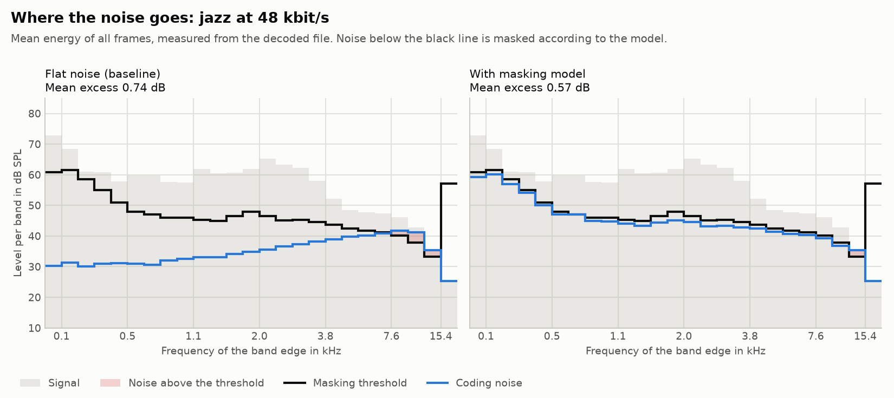

# Perceptual Audio Codec in C++

[](https://github.com/JohannWeid/audio-codec-lab/actions/workflows/ci.yml)

A small MDCT-based perceptual transform codec with a psychoacoustic model, a rate loop and entropy
coding, tested on Windows, Linux and macOS and evaluated with a MUSHRA-style listening test. It is a
learning project about the principles of perceptual coding, not a competitor to AAC or Opus.

**Status: work in progress.** The encoder and decoder work end to end, from WAV to bitstream and
back. A psychoacoustic model shapes the quantization noise, and an adaptive range coder codes the
result. Reference bitstreams decode to identical PCM on Linux, Windows and macOS, on x86-64 and ARM
(see [tests/conformance](tests/conformance/README.md)).

Nobody has listened to it in a test yet, so there are no listening results to show. What exists so
far are measurements on synthetic signals and real excerpts, which show that the noise goes where the
model wants it:



This does not show that it sounds better, and the model's own threshold cannot rank it against AAC or
Opus. The one independent measure so far, ViSQOL, actually prefers flat noise in 32 of 40 cases on real
excerpts, mainly because the model limits the bandwidth at low bitrates. With a looser limit, the model
moves ahead of flat noise from 32 to 64 kbit/s, but then more noise lies above its thresholds at 32 kbit/s.
Whether that trade is worth it is open until someone listens. The [evaluation](eval/README.md) has all
measures, what they can and cannot say, the causes found so far, and the known weaknesses.

| Phase | Content | Status |
|---|---|---|
| 1 | Specification | in progress |
| 2 | Core: WAV, MDCT, quantization, bitstream, encoder and decoder without psychoacoustics | done |
| 3 | Psychoacoustic model, bit allocation with rate loop, better entropy coding | done, not yet tested by ear |
| 4 | Test levels: unit, roundtrip, conformance, end-to-end, damaged input, evaluation | done for the current code |
| 5 | Evaluation: objective metrics and a MUSHRA-style listening test | Measures on synthetic signals done, including ViSQOL, and the [listening test](listening-test/README.md) is prepared; real music and listeners missing |

## Method

```text
Encoder
  PCM --> window + MDCT --> quantization --> entropy coding --> bitstream
   |                             ^
   +--> FFT --> masking model --> bit allocation with rate loop

Decoder
  bitstream --> entropy decoding --> dequantization --> IMDCT + overlap-add --> PCM
```

The noise from quantization is shaped so that it stays below the masking threshold of the signal.
A baseline with the same transform, entropy coder and rate loop but without the psychoacoustic model
shows what the model contributes. The details are in the
[draft specification](spec/codec-spec.md).

## Build and test

You need CMake 3.25 or newer, a C++17 compiler and network access for the first configure, which
downloads GoogleTest.

```bash
cmake --preset default
cmake --build --preset default
ctest --preset default
```

| Preset | Purpose |
|---|---|
| `default` | Release build |
| `ci` | Release build with warnings as errors, used by CI |
| `sanitize` | Debug build with AddressSanitizer and UndefinedBehaviorSanitizer, GCC and Clang only |

## Usage

The input must be a WAV file with 16-bit PCM, 48 kHz and one channel. The tools are in
`build/default`, or in `build/default/Release` on Windows.

```bash
codec-encode in.wav out.bin --bitrate 64000
codec-decode out.bin out.wav
```

`--psy off` selects the baseline for comparison: the same codec with flat noise instead of the
psychoacoustic model. `codec-analyze` takes the same arguments as `codec-encode` and writes a table
with the energy, thresholds and noise per frame and band, see [eval](eval/README.md).

## Repository layout

```text
spec/               Codec and bitstream specification
src/codec/          Codec library
src/tools/          Command-line tools codec-encode, codec-decode and codec-analyze
tests/              Unit tests with GoogleTest
tests/conformance/  Reference bitstreams that every platform must decode to the same result
tests/e2e/          End-to-end tests of the tools with Robot Framework
eval/               Metrics, plots and comparison with AAC and Opus in Python
eval/results/       The tables and figures of the last evaluation
listening-test/     Scripts for the listening test and its analysis, without audio files
.github/workflows/  CI: build matrix, sanitizers, evaluation, formatting
```

## License

The code is under the [MIT License](LICENSE). Audio files used for the evaluation are not part of
this repository; their sources and licenses will be documented in
[listening-test/README.md](listening-test/README.md).
