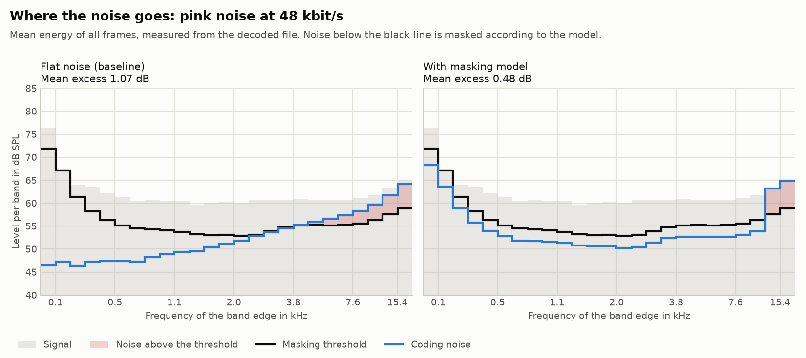
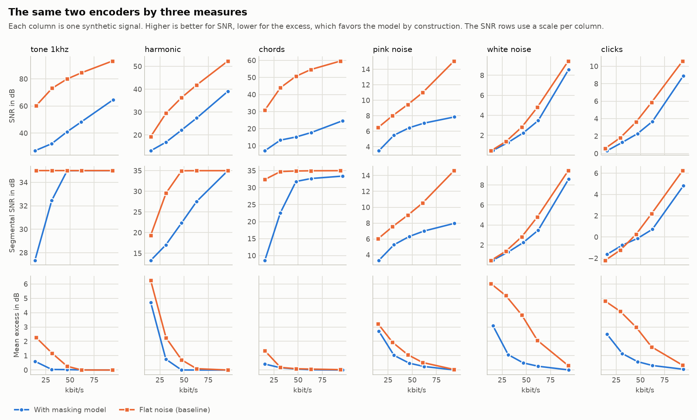
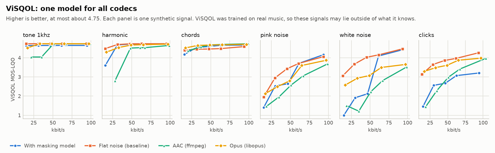
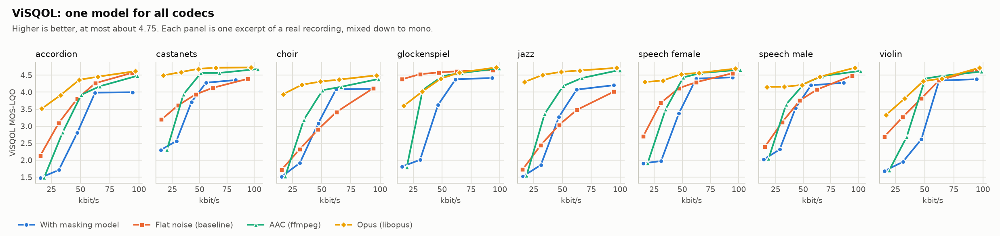
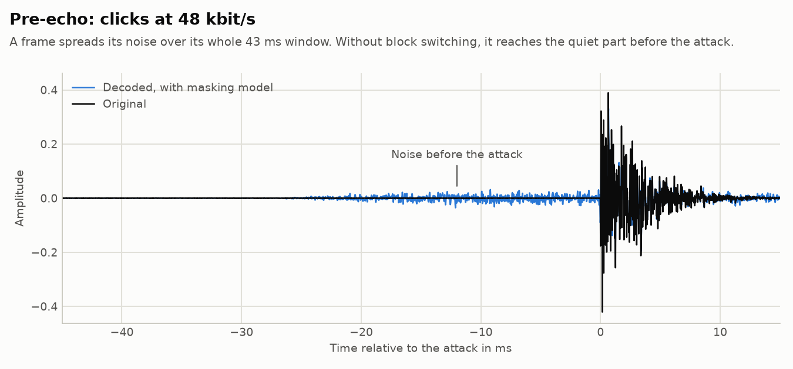

# Evaluation

Runs the codec with and without its model, and AAC and Opus through ffmpeg, on a set of signals and
measures the results. The numbers and figures in [results](results) come from these scripts.

**What this does not show:** it says nothing certain about how the codec sounds. All measures here are
computed, and nobody has listened yet, so only the listening test can answer whether the model is an
improvement. So far, the one independent measure speaks against the model as it stands, mainly because
of its bandwidth limit, see [real music](#real-music).

## Run it

You need the built tools, Python 3.12 or newer, and optionally ffmpeg with libopus. Without ffmpeg,
the comparison with AAC and Opus is left out.

```bash
python -m pip install -r eval/requirements.txt
python eval/evaluate.py --tools build/default --out eval/out
```

This takes about a minute. On Windows, the tools are in `build/default/Release`.

| Option | Meaning |
|---|---|
| `--items folder` | Use WAV files (16 bit, 48 kHz, mono) instead of the synthetic signals |
| `--bitrates 32000 64000` | Other target bitrates, in bit/s |
| `--duration 4` | Length of the synthetic signals in seconds |
| `--visqol folder` | Also rate all files with ViSQOL, from the folder that `build_visqol.sh` created |

[ViSQOL](https://github.com/google/visqol) has no ready-made binaries.
[build_visqol.sh](build_visqol.sh) builds it on Linux with the flags that GCC 15 needs and checks that it
reaches the expected score of ViSQOL's own conformance test, 2.34687. This takes up about 3 GB and about
15 minutes, so CI does not do it, and its tests of this path use a stand-in for the program. The results
in this repository were generated with the real one.

To test the scripts, name the folder of the tools:

```bash
CODEC_TOOLS_DIR=build/default python -m unittest discover --start-directory eval
```

## Signals

[signals.py](signals.py) generates the synthetic ones, so that no licensed audio is needed. Each one
stresses one thing: a single tone, harmonics with quiet gaps, decaying chords, pink noise, white noise,
and short bursts that provoke pre-echo. They are stand-ins and do not replace real music.

The real music is the eight excerpts of the [listening test](../listening-test/README.md#audio). These
commands fetch them and measure them, with ffmpeg and the folder of ViSQOL as above:

```bash
python listening-test/fetch_items.py
python listening-test/make_stimuli.py --tools build/default
python eval/evaluate.py --tools build/default --items listening-test/stimuli/references --out eval/results/music --visqol ~/visqol-build/visqol
```

## Measures

| Measure | Meaning |
|---|---|
| SNR | Energy of the signal over energy of the error, for the whole file |
| Segmental SNR | Mean SNR of 20 ms segments, limited to -10 to 35 dB, without silent segments |
| Mean excess | Mean over all frames and bands of how many dB the noise lies above the masking threshold. Bands below it count as 0. |
| Bands above | Share of all bands in all frames with noise above the masking threshold |
| ViSQOL | The MOS-LQO of ViSQOL in its audio mode, a prediction of the score in a listening test, up to about 4.75 |
| Bitrate | Size of the file over its duration, including the container for AAC and Opus |

The noise always comes from the decoded file: the difference to the original goes through the same
framing and MDCT as in the codec, and the energies are summed per band. So every codec is measured
the same way. Tests check that this MDCT equals the one in the codec and that for this codec the
result agrees per frame and band with what the encoder reports, apart from the rounding to 16 bits.

The tables also include AAC and Opus, but **the excess cannot rank this codec against them**. It uses
the thresholds of this codec's own model, which this encoder aims at and the others do not. It also
compares waveforms, and AAC and Opus may replace noisy parts with synthetic noise, which counts as an
error here but may sound fine. AAC is the encoder built into ffmpeg, not the best one available. Its
bitrate overshoots at low targets, up to 28 instead of 16 kbit/s, so compare with the real bitrates in
the last table. Opus runs in hard CBR, since its usual VBR mode took up to twice the target on tonal
signals.

ViSQOL does not depend on this codec's model, so it is the one measure here that can compare all
codecs. It is still only a prediction, trained on real music, and these synthetic signals are unlike
what it was trained on.

## Results

All tables for the synthetic signals are in [results/results.md](results/results.md), and those for real
music in [results/music/results.md](results/music/results.md). They were generated with ffmpeg 8.0.1. The
numbers for this codec were identical on another machine in CI. Those for AAC and Opus differed there by
up to 2.4 dB of SNR, probably because of another version of ffmpeg, so small differences between them
mean little.



With the model, the noise follows the masking threshold and stays below it up to the bandwidth limit,
which is 11.4 kHz at 48 kbit/s. The two top bands are not coded, so their whole energy counts as noise.
Flat noise leaves the low bands with a margin that is not needed and crosses the threshold from about
5 kHz on. The figures for the other signals are in the same folder.



The measures disagree, which is the point of showing all of them. At 48 kbit/s on the chords, the SNR
drops from 50.7 to 15.1 dB with the model. On white noise, the bands above the threshold drop from
95.9 % to 11.8 %. The excess favors the model by construction, since the encoder aims at exactly these
thresholds. So this is evidence that the model does what it is designed to do, not that it sounds
better.

### ViSQOL disagrees



ViSQOL prefers flat noise to the model in 25 of the 30 cases, in places by a wide margin: on white noise
at 32 kbit/s it gives 1.00 against 3.66, on pink noise at 48 kbit/s 2.05 against 3.43. The model is ahead
only on the chords from 48 kbit/s on and on pink noise at 96 kbit/s. On the noise signals, flat noise also
beats AAC and Opus, which replace noise with something that only sounds similar. That hints that ViSQOL
rewards the exact waveform on such signals, so these scores should not be taken too literally.

Counter-checks with modified copies of the encoder show two causes. The scripts do not produce these
figures, and these changes are not in the codec.

| Signal and bitrate | Model | Model without limit | Flat noise | Flat noise with limit |
|---|---:|---:|---:|---:|
| White noise, 32 kbit/s | 1.00 | 3.47 | 3.66 | 1.00 |
| Pink noise, 48 kbit/s | 2.05 | 3.59 | 3.43 | 2.04 |
| Harmonic, 16 kbit/s | 2.37 | 3.75 | 4.48 | 2.36 |
| Clicks, 96 kbit/s, where no limit applies | 3.21 | 3.21 | 4.26 | 4.26 |

- **The bandwidth limit** is the main cause. With the same limit, flat noise falls to the scores of the
  model, and without it the model moves ahead on pink noise. But the two measures pull in
  opposite directions: without the limit, the mean excess on pink noise at 32 kbit/s rises from 1.02 to
  4.57 dB. So it is open which is right, the clean but dull sound with the limit or the full bandwidth
  with more audible noise. That takes listening.
- **The quiet background** explains the clicks. In the decoded file, the part between the clicks was
  replaced with the original, then the part before each attack, then the clicks. At 96 kbit/s, the first
  lifts the model from 3.21 to 4.49, level with flat noise at 4.51, while the second adds 0.12 and the
  third nothing. So on this signal ViSQOL does not object to pre-echo, as might be expected, but to the
  background at about -72 dBFS, which the model holds to be inaudible and does not code. That may
  well be right at a normal listening level, and it may matter little on real recordings.

Without the limit, the model is still behind flat noise on white noise, by 0.05 to 0.32, on the harmonic
signal at 16 kbit/s (3.75 against 4.48), and on the chords at 16 kbit/s (4.19 against 4.39). So the two
causes do not explain everything.

### Real music



On the eight excerpts, the picture is clearer. As it stands, the model is behind flat noise in 32 of the
40 cases by ViSQOL, while its mean excess is lower from 32 kbit/s on. The column "1 bit" comes from a
modified copy of the encoder, not from the codec: it allows 1 bit per coded coefficient instead of 1.75,
which raises the bandwidth at 32 and 48 kbit/s to 15.4 kHz. Removing the limit altogether changes the
scores no further at these bitrates, apparently because the excerpts lie below the threshold in quiet
above that frequency.

| kbit/s | ViSQOL: model | 1 bit | Flat noise | AAC | Opus | Excess in dB: model | 1 bit | Flat noise |
|---:|---:|---:|---:|---:|---:|---:|---:|---:|
| 16 | 1.78 | 1.80 | 2.62 | 1.79 | 3.95 | 3.48 | 4.09 | 3.20 |
| 32 | 2.04 | 3.96 | 3.26 | 3.40 | 4.19 | 1.44 | 2.36 | 1.62 |
| 48 | 3.25 | 4.14 | 3.74 | 4.28 | 4.43 | 0.55 | 0.74 | 0.86 |
| 64 | 4.22 | 4.22 | 4.08 | 4.42 | 4.52 | 0.22 | 0.22 | 0.49 |
| 96 | 4.27 | 4.27 | 4.43 | 4.60 | 4.67 | 0.01 | 0.01 | 0.15 |

All values are means over the excerpts.

- **At 48 kbit/s, the looser limit is ahead of flat noise by ViSQOL and by the mean excess**, on 7 of the
  8 excerpts by ViSQOL. More bands do lie above the threshold, 31 % against 20 %, but by less on average.
- **At 32 kbit/s, the measures disagree.** By ViSQOL, the looser limit is well ahead (3.96 against 3.26,
  7 of 8 excerpts), but 64 % of the bands lie above the threshold, against 33 % with flat noise and 32 %
  with the present limit. That is the choice between dull and noisy, and it takes listening.
- **At 16 kbit/s, a limit of 1 bit does not help.** Only far looser settings do: 0.5 bits give 2.85, and
  removing the limit 3.36, with an excess of 4.70 dB. That may well sound worse than the score suggests.
- **The glockenspiel stays with flat noise** at every bitrate, for example 4.30 against 4.53 at 32 kbit/s
  with the looser limit.
- **At 96 kbit/s, flat noise is ahead** (4.43 against 4.27), though no limit applies. Keeping the bands
  below the threshold in quiet gives 4.35, so that is a part of the reason, but not all of it.
- **Opus is ahead of every version of this codec at every bitrate**, and AAC from 48 kbit/s on, which is
  no surprise for a small codec without block switching, noise filling or a bit reservoir.

The codec still has the old limit. Whether it changes depends on what listening says at 32 kbit/s.

### Known weaknesses

- **Pre-echo.** A frame spreads its noise over its whole window. Before an attack that is clearly
  visible, and it will probably be audible. There is no block switching.

  

- **Attacks get too few bits.** On the chords at 48 kbit/s with the model, the frames within one frame
  of a note start are 9 % of all frames. They hold 97 % of the noise energy, and 21 % of their bands
  lie above the threshold, against 0.5 % elsewhere. In the other frames, the noise lies 29 dB below the
  threshold in the median. So bits are left over there while the attacks run short, because each frame
  has the same fixed budget. A bit reservoir could address this. These figures come from one separate
  check of the `codec-analyze` table and the decoded file; the scripts do not produce them.
- **Hardly any gain on tonal music.** On the same signal, the mean excess is about the same with the
  model and with flat noise (0.07 against 0.09 dB), slightly more bands lie above the threshold (2.3 %
  against 1.6 %), and the SNR is 36 dB lower. A sparse signal leaves flat noise enough room, so the
  listening test needs tonal items.
- **Low bitrates.** On the harmonic signal and on pink noise at 16 kbit/s, and on the harmonic signal
  at 32 kbit/s, the mean excess is lower with the model, but more bands lie above the threshold than
  with flat noise (63 % against 54 %, 78 % against 69 %, 42 % against 31 %).

## The table of codec-analyze

`codec-analyze in.wav out.csv --bitrate 64000 [--psy on|off]` runs the encoder and writes one line per
frame and band. All energies are on the scale of the MDCT coefficients, where a full scale sine has an
energy of 512 per frame, which the model equates with 96 dB SPL.

| Column | Meaning |
|---|---|
| `frame`, `band` | Position in the signal and in the spectrum |
| `first_coefficient`, `last_coefficient` | The coefficients of the band |
| `energy` | Energy of the signal in the band |
| `masking_threshold`, `quiet_threshold` | Thresholds of the model, also listed with `--psy off` |
| `noise` | Energy of the quantization error in the band |
| `payload_bytes`, `budget_bits` | Size of the frame and the bits it was allowed to use |
